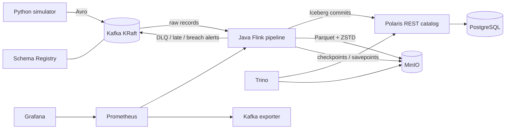

# Real-Time Cold-Chain Sensor Data Lakehouse

[](https://github.com/saadabdullah-15/real-time-cold-chain-lakehouse/actions/workflows/unit.yml)
[](https://github.com/saadabdullah-15/real-time-cold-chain-lakehouse/actions/workflows/integration.yml)

A reproducible streaming lakehouse for refrigerated-shipment telemetry. The project simulates
temperature, humidity, battery, GPS, door, and shock events; processes them with event-time
semantics in Apache Flink; and stores auditable bronze, silver, and gold datasets in Apache
Iceberg.

The complete platform runs on Docker Compose. Kafka, Schema Registry, Flink, Polaris, PostgreSQL,
MinIO, Trino, Prometheus, Grafana, the simulator, bootstrap utilities, builds, tests, and
verification are all included in the repository.

This project treats correctness claims as testable invariants. Every published Kafka coordinate is
recorded in a run manifest and reconciled against bronze, terminal silver outcomes, and finalized
gold aggregates. See [validation evidence](docs/evidence/README.md) for the evidence format and
publication rules.

## What the project demonstrates

- Defensive ingestion that preserves raw bytes even when Avro decoding fails.
- Payload-time watermarks applied after buffered temporal enrichment.
- Effective-dated shipment metadata rather than a latest-value-only join.
- Stateful `event_id` deduplication with a 24-hour TTL and explicit duplicate disposition.
- Invalid, missing-metadata, and too-late quarantine paths.
- Shipment-specific temperature breach detection and Kafka alerts.
- Checkpointed Iceberg writes, RocksDB state, and savepoint restoration.
- Run-scoped publication manifests and exact cross-layer reconciliation.
- Schema, partition, snapshot, time-travel, compaction, and expiration workflows.
- Metrics for throughput, lag, invalid data, duplicates, lateness, backpressure, checkpoints, and
  restarts.

## Architecture



The simulator publishes deterministic, fault-injected records with Confluent Avro framing. Flink
first captures the exact Kafka record, then decodes, validates, deduplicates, enriches, assigns
canonical event time, routes late data, detects breaches, and computes hourly shipment metrics.
Trino queries the same Iceberg catalog and object store written by Flink.

The detailed operator flow and delivery semantics are documented in
[docs/architecture.md](docs/architecture.md).

## Processing guarantees

### Raw-first ingestion

`bronze.raw_events` receives the original topic, partition, offset, Kafka timestamp, key, schema
ID, payload, and ingestion time. Avro decoding happens in a guarded process function after the raw
branch, so malformed bytes are preserved and quarantined without creating a restart loop.

### Canonical event time

The payload `event_time` is canonical. Flink rejects a Kafka timestamp difference greater than one
second with `EVENT_TIME_MISMATCH`. The raw source emits no watermarks; timestamps and the
60-second-bounded-out-of-order watermark are assigned after temporal enrichment. Partitions become
idle after 30 seconds.

This placement prevents buffered events from inheriting a metadata record's timestamp when they
are released. Hourly windows remain updateable for five minutes. Events beyond the active
lateness boundary are written with disposition `TOO_LATE`.

### Temporal metadata

Device metadata is versioned by `metadata_version` and `effective_from`. For each event, Flink
selects the latest version whose effective timestamp is not after the event timestamp.

Compacted metadata keys use:

```text
<device_id>:v<metadata_version>
```

This retains historical versions in Kafka. Metadata should be published before dependent events;
Flink buffers ordinary cross-topic ordering differences for ten seconds. A newly published
backdated correction requires replay from bronze to recalculate previously enriched history.

### Deduplication and rejection

Valid sensor, location, and detection records are keyed by `event_id`. The first record is retained
and subsequent occurrences within the 24-hour state TTL are written to
`silver.rejected_events` with disposition `DUPLICATE` and their own source coordinates.

Other terminal rejection dispositions are:

| Disposition | Meaning |
|---|---|
| `INVALID` | Avro decoding or logical contract validation failed |
| `DUPLICATE` | The `event_id` was already seen within the TTL |
| `MISSING_METADATA` | No effective metadata version became available |
| `TOO_LATE` | The event exceeded the allowed event-time lateness boundary |

### Checkpoint and sink semantics

Flink is configured with:

- 60-second exactly-once checkpoints;
- one concurrent checkpoint;
- a two-minute checkpoint timeout;
- incremental RocksDB state in MinIO;
- retained externalized checkpoints;
- fixed-delay restart behavior;
- runtime parallelism 2 and stable maximum parallelism 128;
- explicit stable operator UIDs for savepoint-compatible upgrades.

Each Iceberg sink commits exactly once at successful checkpoints. Kafka DLQ, late, and breach
sinks use exactly-once transactions with separate transactional ID prefixes.

Iceberg commits across different tables are independent. A checkpoint does not create one atomic
multi-table transaction, so readers may briefly observe checkpoint-scale visibility skew before
all tables converge.

## Data contracts

All valid input records carry:

```text
event_id
device_id
event_time
produced_at
sequence_number
```

Sensor topics use `device_id` as the Kafka key. Metadata uses the version-preserving composite key
described above. Schema Registry compatibility is configured as `FULL_TRANSITIVE`, and simulator
schema auto-registration is disabled.

| Topic | Partitions | Cleanup | Purpose |
|---|---:|---|---|
| `coldchain.telemetry.v1` | 6 | Delete, 7 days | Temperature, humidity, and battery |
| `coldchain.location.v1` | 3 | Delete, 7 days | Position, speed, and GPS accuracy |
| `coldchain.detection.v1` | 3 | Delete, 7 days | Door-open, door-close, and shock detections |
| `coldchain.device-metadata.v1` | 3 | Compact | Effective-dated device and shipment history |
| `coldchain.dlq.v1` | 3 | Delete, 30 days | Decode and validation failures |
| `coldchain.late.v1` | 3 | Delete, 30 days | Too-late events |
| `coldchain.breach-alerts.v1` | 3 | Delete, 30 days | Temperature-threshold alerts |

Validation covers identifiers, sequence numbers, timestamps, Kafka keys, telemetry units and
ranges, latitude/longitude, speed, GPS accuracy, detection types, metadata versions, and shipment
temperature bounds.

## Lakehouse model

All tables use Iceberg format v2, Parquet files, and ZSTD compression.

| Layer and table | Write model | Partitioning | Purpose |
|---|---|---|---|
| `bronze.raw_events` | Append | Kafka day | Exact source record and replay boundary |
| `silver.device_metadata_history` | Upsert by device/version | Unpartitioned | Effective-dated shipment metadata |
| `silver.enriched_events` | Upsert by event/day | Event day | Valid, unique, historically enriched events |
| `silver.rejected_events` | Append | Rejection day | Explicit terminal rejection outcomes |
| `gold.shipment_hourly_metrics` | Upsert by shipment/window/day | Window day | Hourly conditions, detections, breaches, and position |

The controlled v2 deployment adds nullable `signal_strength_dbm` and evolves
`silver.enriched_events` to:

```text
event_day, bucket(event_id, 8)
```

Both partition source fields belong to the table's upsert equality key. Existing files remain
readable under the original event-day-only specification.

## Prerequisites

- Docker Desktop with Docker Compose v2
- At least 4 CPUs and 10 GB RAM assigned to Docker
- PowerShell 7, available as `pwsh`

Local Java, Maven, Python, and Make installations are not required. All exposed ports bind to
`127.0.0.1`. On first use, the operator script copies `.env.example` to an ignored `.env` and
replaces the template passwords with generated local credentials.

## Quick start

```powershell
git clone https://github.com/saadabdullah-15/real-time-cold-chain-lakehouse.git
cd real-time-cold-chain-lakehouse
pwsh ./scripts/coldchain.ps1 demo
```

The `demo` command:

1. Builds and starts the complete platform.
2. Waits for Kafka, Schema Registry, MinIO, Polaris, Flink, and Trino.
3. Idempotently creates buckets, topics, schemas, catalog roles, and namespaces.
4. Publishes 100,000 simulated sensor events at 500 events/second, plus metadata and duplicate
   deliveries.
5. Writes a manifest only after all Kafka delivery callbacks succeed.
6. Waits for a checkpoint newer than the run.
7. Reconciles the run through Trino.

The first start downloads images and dependencies and builds the pinned MinIO community release
from source. Later starts reuse Docker and Maven caches.

## Operator commands

```powershell
pwsh ./scripts/coldchain.ps1 <command>
```

| Command | Behavior |
|---|---|
| `up` | Build and start the platform; wait for Flink and Trino |
| `status` | Display container state and local endpoints |
| `demo` | Publish and reconcile the 100k-event accelerated workload |
| `benchmark` | Publish and reconcile the 300k-event benchmark workload |
| `verify` | Reconcile the latest manifest or the path in `MANIFEST_PATH` |
| `failure-drill` | Kill the TaskManager during ingestion, recover, and reconcile |
| `test` | Run Python and Java tests in containers |
| `down` | Stop services while retaining volumes and manifests |
| `reset` | Delete project volumes and generated run manifests after confirmation |

`reset` is destructive. For intentional non-interactive cleanup:

```powershell
pwsh ./scripts/coldchain.ps1 reset -Force
```

## Simulator profiles

| Profile | Sensor events | Simulated event-time span | Default publish rate |
|---|---:|---:|---:|
| `baseline` | 100,000 | 24 hours | About 1.16 events/s |
| `demo` | 100,000 | 24 hours | 500 events/s |
| `benchmark` | 300,000 | 5 minutes | 1,000 events/s |

Default fault injection:

- 1% duplicate deliveries;
- 0.5% invalid records;
- 5% out-of-order events;
- 1% events delayed by more than five minutes.

Metadata and duplicate deliveries are additional Kafka records, so `delivered_total` is normally
greater than the configured sensor-event count.

Run a smaller custom workload after starting the platform:

```powershell
docker compose --env-file .env --profile tools run --rm simulator `
  --profile demo `
  --run-id run-local-example `
  --events 10000 `
  --rate 500 `
  --devices 100 `
  --seed 7
```

Available overrides include:

```text
--profile
--run-id
--events
--rate
--event-time-span-seconds
--seed
--devices
--duplicate-rate
--invalid-rate
--out-of-order-rate
--too-late-rate
--schema-version
--manifest
--dry-run
```

If `--run-id` is omitted, the simulator creates:

```text
run-<UTC timestamp>-<8 hex>
```

Device, shipment, vehicle, and deterministic event IDs are namespaced by the run ID. Consecutive
runs therefore remain independently queryable without collisions.

## Run manifests

Successful publications write manifest version 2 to:

```text
data/runs/<run-id>/manifest.json
```

The file is created atomically only after:

- `Producer.flush()` returns zero queued messages;
- every delivery callback succeeds;
- attempted and confirmed delivery counts match.

The manifest contains run status and timestamps, configuration, attempted and delivered totals,
achieved publish rate, generation counters, and compressed Kafka topic/partition/offset ranges.
Those ranges define the exact verification scope; reconciliation does not depend on table-wide
counts or timestamps.

Dry runs use status `DRY_RUN` and do not claim Kafka deliveries.

## Verification

Run the latest completed manifest:

```powershell
pwsh ./scripts/coldchain.ps1 verify
```

Select a specific run:

```powershell
$env:MANIFEST_PATH = "data/runs/<run-id>/manifest.json"
pwsh ./scripts/coldchain.ps1 verify
```

The verifier waits for the bronze and terminal silver commits, then checks:

- manifest version, completion status, and delivery accounting;
- exactly one bronze row for every delivered Kafka coordinate;
- no duplicate bronze topic/partition/offset coordinate;
- exactly one terminal silver outcome for every delivery;
- no coordinate duplicated across metadata, enriched, or rejected tables;
- exact metadata, invalid, and duplicate disposition counts;
- bounded and nonzero too-late output when late injection is present;
- unique enriched `event_id` values within the run;
- field-by-field equality between finalized gold windows and aggregates recomputed from run-scoped
  silver rows.

Floating-point aggregates use a small comparison tolerance. Only event-time windows that are past
the watermark and allowed-lateness boundary are treated as finalized.

## Querying with Trino

Run the included SQL through the containerized CLI:

```powershell
docker compose --env-file .env exec -T trino trino --file /sql/verification.sql
docker compose --env-file .env exec -T trino trino --file /sql/analytics.sql
```

The analytics include:

- shipment temperature exposure;
- route and GPS reporting gaps;
- hourly conditions and breach counts;
- rejection rates;
- current shipment state.

Snapshot inspection, time travel, file compaction, and guarded expiration examples are in
[sql/maintenance.sql](sql/maintenance.sql).

## Observability

Prometheus scrapes Flink and Kafka exporter metrics. Grafana provisions the
`Cold-Chain Lakehouse Overview` dashboard with panels for:

- input and output throughput;
- Kafka consumer lag;
- Flink backpressure;
- invalid records;
- duplicates removed;
- too-late records;
- breach alert rate;
- completed and failed checkpoints;
- job restarts.

Prometheus retains local data for 15 days.

## Local endpoints

| Service | Address |
|---|---|
| Kafka broker | `127.0.0.1:9092` |
| Flink dashboard | http://127.0.0.1:8081 |
| Trino | http://127.0.0.1:8080 |
| Schema Registry | http://127.0.0.1:8085 |
| Polaris catalog API | http://127.0.0.1:8181 |
| MinIO API | http://127.0.0.1:9000 |
| MinIO console | http://127.0.0.1:9001 |
| Prometheus | http://127.0.0.1:9090 |
| Grafana | http://127.0.0.1:3000 |

Use the generated values in `.env` for MinIO and Grafana sign-in.

## Failure recovery

The failure drill runs the benchmark producer, force-stops the TaskManager during ingestion,
recreates it, waits for all Flink tasks to return to `RUNNING`, and performs the same exact
reconciliation:

```powershell
pwsh ./scripts/coldchain.ps1 failure-drill
```

The command reports the measured time until Flink returns to the running state. Treat RPO,
throughput, recovery, and lag claims as publishable only when the corresponding manifest,
checkpoint JSON, lag data, and verifier output are retained.

## Schema and partition evolution

The repository starts with telemetry schema v1. The controlled v2 workflow is:

1. Write and verify v1 data.
2. Stop the Flink job with a savepoint in MinIO.
3. Check `telemetry-v2.avsc` under `FULL_TRANSITIVE` compatibility.
4. Explicitly register v2; the simulator cannot auto-register it.
5. Add nullable `signal_strength_dbm`.
6. Evolve partitioning to `event_day, bucket(event_id, 8)`.
7. Restore the Flink job from the savepoint.
8. Publish and verify v2 records.
9. Confirm old rows are null and new telemetry rows populate the field.
10. Demonstrate snapshots, time travel, compaction, and guarded expiration.

Use the exact commands and safety boundary in [docs/evolution.md](docs/evolution.md).

## Testing and CI

Run the containerized test suites:

```powershell
pwsh ./scripts/coldchain.ps1 test
```

Python coverage includes simulator determinism, fault injection, run-ID isolation, publisher
flush and callback failures, atomic manifests, offset compression, Trino pagination and error
reporting, and exact reconciliation.

Java coverage includes validation, Avro mapping, aggregation, deduplication TTL, duplicate side
output, snapshot restore, late-boundary behavior, metadata ordering, missing-metadata timers, and
buffered event-time preservation. A Flink MiniCluster test runs at parallelism 2 and proves that
delayed metadata still places an event in the payload-time hourly window.

GitHub Actions:

- runs Ruff lint and format checks plus Python tests;
- runs `mvn verify` on Java 17;
- validates the Compose model;
- runs the reduced 10k-event Docker integration weekly and on manual dispatch;
- retains the manifest, verifier output, Flink API JSON, and service logs for 30 days.

Action references are SHA-pinned. Dependabot checks GitHub Actions, Python, and Maven dependencies
weekly.

## Validation evidence

Configured rate is workload demand, not measured capacity. Before publishing a performance or
recovery claim, retain:

- commit SHA and clean-worktree state;
- host hardware and Docker allocation;
- run manifests and verifier output;
- completed and failed checkpoint counts;
- peak and final Kafka lag plus drain time;
- recovery time and RPO result;
- relevant Flink and Grafana screenshots.

The required run sequence, sanitized pack layout, and templates are in
[docs/evidence/README.md](docs/evidence/README.md). The benchmark procedure is in
[docs/benchmark.md](docs/benchmark.md).

## Technology versions

| Component | Version |
|---|---|
| Python | 3.11 |
| Java | 17 |
| Kafka | 4.2.1 |
| Schema Registry | 8.2.2 |
| Flink | 2.1.3 |
| Flink Kafka connector | 5.0.0-2.1 |
| Iceberg | 1.11.0 |
| Polaris | 1.6.0 |
| Trino | 483 |
| PostgreSQL | 17.6 |
| Prometheus | 3.13.1 |
| Grafana OSS | 13.0.3 |
| MinIO | `RELEASE.2025-10-15T17-29-55Z`, built from source |

## Repository layout

| Path | Purpose |
|---|---|
| `simulator/` | Deterministic generation, fault injection, Avro serialization, and publishing |
| `schemas/` | Avro v1 contracts and additive telemetry v2 |
| `flink-job/` | Java pipeline, models, stateful functions, sinks, and tests |
| `tools/` | Idempotent bootstrap, explicit v2 registration, and Trino reconciliation |
| `sql/` | Analytics, verification, evolution, time travel, and maintenance |
| `infrastructure/` | Container builds and Trino, Prometheus, and Grafana configuration |
| `scripts/coldchain.ps1` | Operator interface |
| `docs/` | Architecture, decisions, evolution, evidence, troubleshooting, and service mapping |
| `data/runs/` | Ignored generated run manifests |

## Documentation

- [Architecture and data flow](docs/architecture.md)
- [Design decisions and limitations](docs/design-decisions.md)
- [Schema and partition evolution](docs/evolution.md)
- [Benchmark procedure](docs/benchmark.md)
- [Validation evidence](docs/evidence/README.md)
- [Troubleshooting](docs/troubleshooting.md)
- [AWS service mapping](docs/aws-mapping.md)
- [Project brief](docs/project-brief.md)

## Operational boundaries

This is a single-machine reference implementation, not a highly available production deployment.

- Kafka runs as one combined broker/controller.
- Flink runs one JobManager and one two-slot TaskManager.
- PostgreSQL, Polaris, MinIO, Trino, Prometheus, and Grafana are single-instance services.
- Local credentials are generated, but traffic is not encrypted.
- No multi-broker failover, catalog HA, or distributed Trino worker pool is included.
- The last open event-time window remains active until the watermark advances.
- Cross-table Iceberg commits are not one atomic transaction.
- Backdated metadata corrections require controlled replay.
- Kubernetes, cloud deployment, Terraform, TLS, and centralized secret management are outside the
  local runtime.

Production-oriented extensions are discussed in
[docs/design-decisions.md](docs/design-decisions.md) and
[docs/aws-mapping.md](docs/aws-mapping.md).

## References

- [Apache Flink production readiness](https://nightlies.apache.org/flink/flink-docs-stable/docs/ops/production_ready/)
- [Apache Flink testing](https://nightlies.apache.org/flink/flink-docs-release-2.1/docs/dev/datastream/testing/)
- [Apache Iceberg engine compatibility](https://iceberg.apache.org/multi-engine-support/)
- [Apache Iceberg Flink writes](https://iceberg.apache.org/docs/latest/flink-writes/)
- [Apache Polaris](https://polaris.apache.org/)
- [Trino Iceberg connector](https://trino.io/docs/current/connector/iceberg.html)
- [Pinned MinIO community release](https://github.com/minio/minio/releases/tag/RELEASE.2025-10-15T17-29-55Z)
