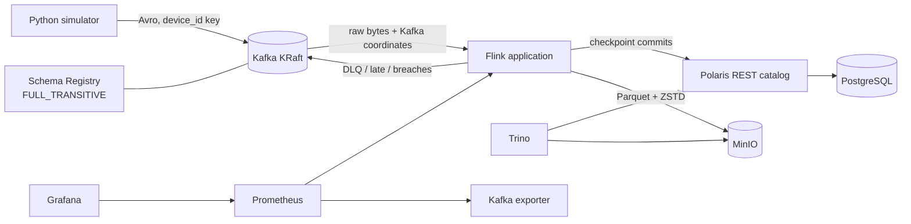
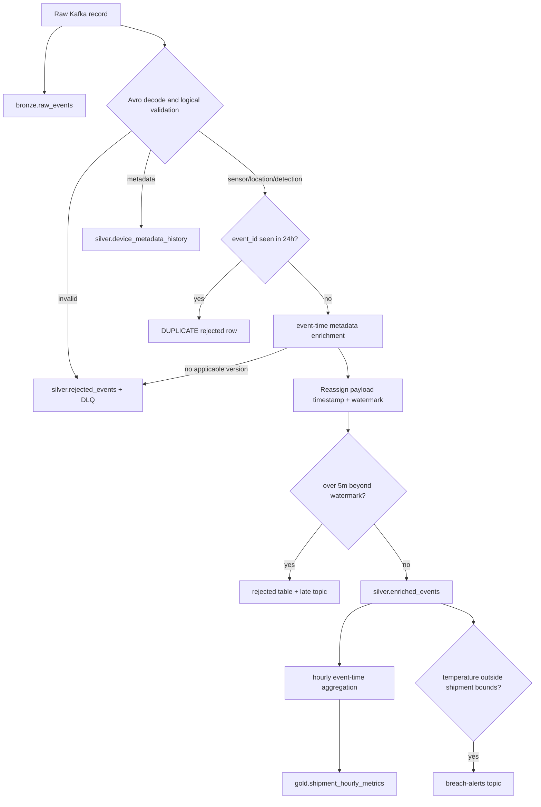

# Architecture and data flow

## Runtime topology

Flink reads all four source topics through one raw source so the first durable representation can
preserve topic, partition, offset, Kafka timestamp, key, schema ID, and exact payload. Decode errors
therefore do not prevent bronze capture. The raw source deliberately emits no watermarks. Valid
sensor records proceed through keyed deduplication; metadata is stored as keyed temporal history
and selected by `effective_from <= event_time` with the greatest matching version.

The payload `event_time` is canonical. Validation permits at most one second of difference from
Kafka `CreateTime`. After temporal enrichment releases immediate or buffered events, Flink assigns
timestamps from the payload and then generates the 60-second-out-of-order, 30-second-idle
watermarks. An event released while processing a metadata record therefore cannot accidentally use
the metadata record's timestamp for late routing or hourly windowing.

## Processing sequence

## Delivery semantics

- The Kafka source participates in Flink checkpoints and reads committed transactions.
- Iceberg sink commits become visible only after successful checkpoints and are exactly once for
  each individual table.
- Kafka alert/DLQ/late sinks use unique transactional ID prefixes and exactly-once delivery.
- A checkpoint can commit several independent sinks, but those table commits do not form an atomic
  transaction across all bronze, silver, and gold tables. Reconciliation tolerates short-lived
  visibility skew and checks the final converged state.
- `bronze.raw_events` is append-only. Its `(topic, partition, offset)` uniqueness is an acceptance
  invariant rather than an update key.

## Metadata publication contract

Metadata is compacted by `<device_id>:v<metadata_version>`, not only by device, so Kafka retains
every effective-dated version. A metadata version must be published before events that depend on
it. Flink waits briefly for ordinary cross-topic ordering differences, but this is not an
unbounded correction mechanism. A newly published backdated correction requires replaying the
affected Kafka coordinates from `bronze.raw_events` so already-enriched rows are recalculated.

## Stateful upgrade contract

Every pipeline operator has an explicit stable UID. Runtime parallelism must be positive and no
greater than `FLINK_MAX_PARALLELISM`, which defaults to 128 and cannot exceed Flink's 32,768 limit.
Keep the maximum parallelism and stateful UIDs unchanged across savepoint restores unless the
upgrade deliberately includes state migration.
